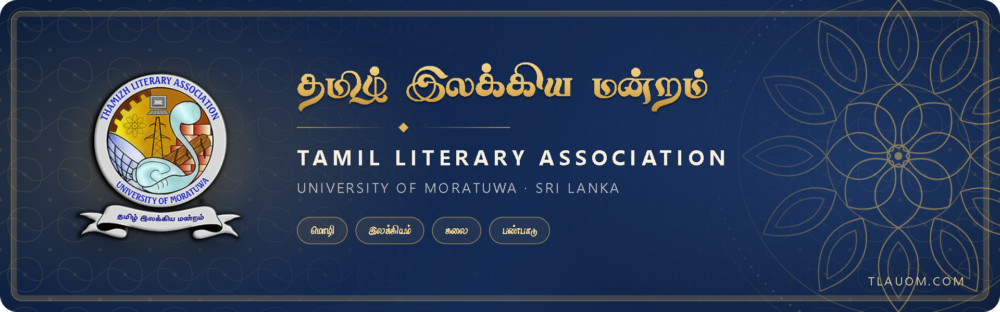
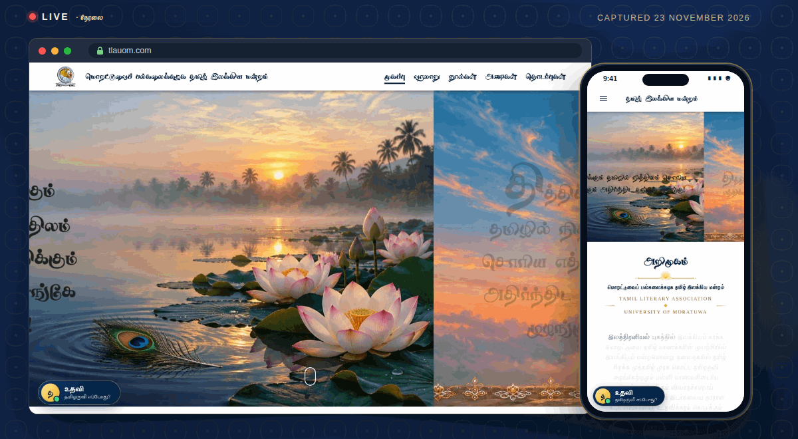
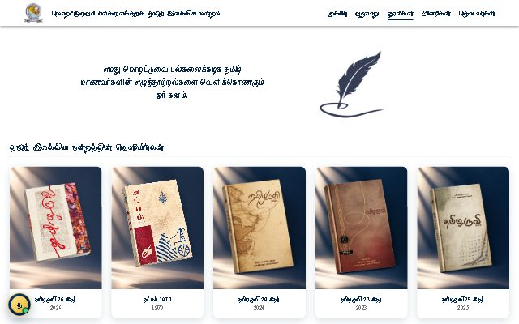
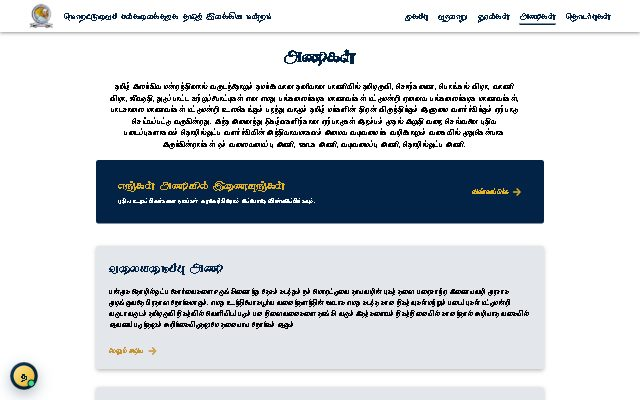
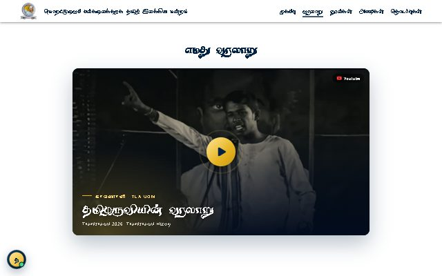
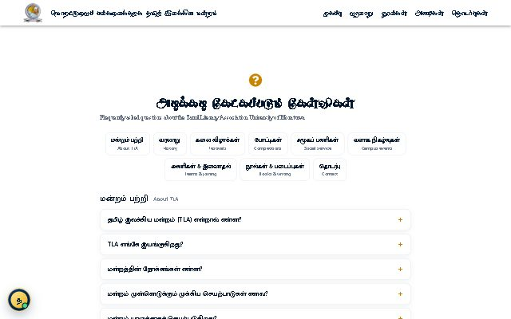
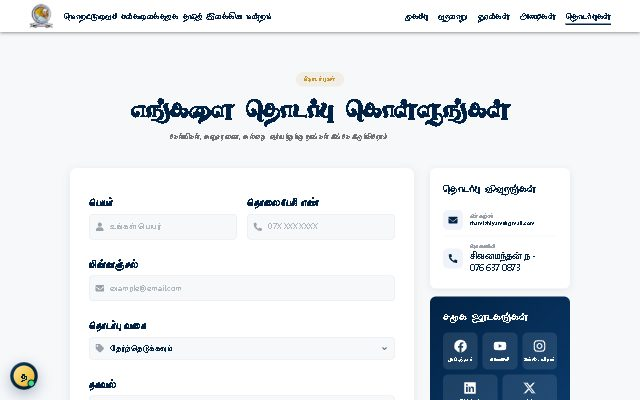
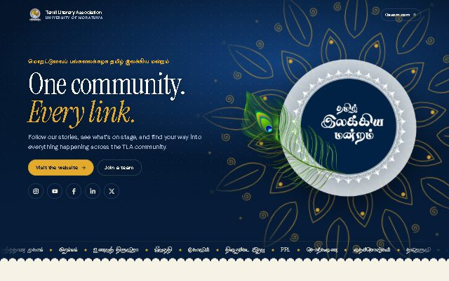
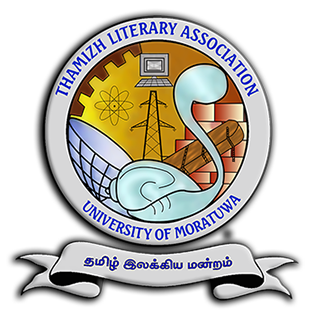

  
  
  
  
  
  

  <b>மொழி · இலக்கியம் · கலை · பண்பாடு</b> 
  Language · Literature · Art · Culture: Tamil students of the University of Moratuwa, Sri Lanka

---

### 🔴 &nbsp;Live from tlauom.com

  

### 🧭 &nbsp;Explore the website

<table>
  <tr>
    <td width="33%" align="center" valign="top">
      
       <b>நூல்கள்</b> Books and magazines: read online or download
    </td>
    <td width="33%" align="center" valign="top">
      
       <b>அணிகள்</b> Our four teams, and how to join them
    </td>
    <td width="33%" align="center" valign="top">
      
       <b>எமது வரலாறு</b> Our history
    </td>
  </tr>
  <tr>
    <td width="33%" align="center" valign="top">
      
       <b>கேள்விகள்</b> Frequently asked questions
    </td>
    <td width="33%" align="center" valign="top">
      
       <b>தொடர்புகள்</b> Get in touch with us
    </td>
    <td width="33%" align="center" valign="top">
      
       <b>எல்லா இணைப்புகளும்</b> All our links in one place
    </td>
  </tr>
</table>

### 🎉 &nbsp;What we do

<table>
  <tr>
    <td width="33%" align="center" valign="top">
      
       <b>தமிழருவி</b> Our annual arts festival, held in Colombo
    </td>
    <td width="33%" align="center" valign="top">
      
       <b>சொற்கணை</b> Island-wide debate championship
    </td>
    <td width="33%" align="center" valign="top">
      
       <b>பிரம்மம்</b> Online talent competitions for students everywhere
    </td>
  </tr>
  <tr>
    <td width="33%" align="center" valign="top">
      
       <b>நிரலி</b> All-island innovation competition for school students
    </td>
    <td width="33%" align="center" valign="top">
      
       <b>ஜீவநதி</b> Our community help journey
    </td>
    <td width="33%" align="center" valign="top">
      
       <b>இரத்ததான முகாம்</b> Yearly blood donation camp
    </td>
  </tr>
  <tr>
    <td width="33%" align="center" valign="top">
      
       <b>வாணி விழா</b> Navaratri evening of music and dance
    </td>
    <td width="33%" align="center" valign="top">
      
       <b>தைப்பொங்கல்</b> Pongal on campus with traditional games
    </td>
    <td width="33%" align="center" valign="top">
      
       <b>அரமியம்</b> Career guidance for final-year students
    </td>
  </tr>
</table>

  Also: <a href="https://tlauom.com/events/food-festival">உணவுத் திருவிழா</a> ·
  <a href="https://tlauom.com/events/ppl">PPL cricket</a> ·
  <a href="https://tlauom.com/events/movie-night">திரைப்பட இரவு</a> ·
  <a href="https://tlauom.com/events/kovil">கோவில்</a>

### 🛠️ &nbsp;Our code

<table>
  <tr>
    <td>
      <a href="https://github.com/Tamil-Literary-Association/TLA-Web-Page"><b>TLA-Web-Page</b></a> 
      The source of <a href="https://tlauom.com">tlauom.com</a>: events, books, members, teams and the FAQ helper.  
      
      
      
    </td>
  </tr>
</table>

### 🤝 &nbsp;Get involved

- **Students at UoM:** join one of our four teams: [வலையமைப்பு](https://tlauom.com/teams/1) · [ஊடகம்](https://tlauom.com/teams/2) · [வடிவமைப்பு](https://tlauom.com/teams/3) · [தொழில்நுட்பம்](https://tlauom.com/teams/4). Apply at [tlauom.com/teams/join](https://tlauom.com/teams/join).
- **Want to work on the website?** The **தொழில்நுட்ப அணி** (Tech team) looks after it. Ask to be added to this organisation, then open a pull request.
- **Questions?** Email **thamizhiyam@gmail.com** or message us on any of the pages above.

---

   
  The website pictures on this page are captured automatically from tlauom.com every week. Last captured <!--captured-->23 November 2026<!--/captured-->.

